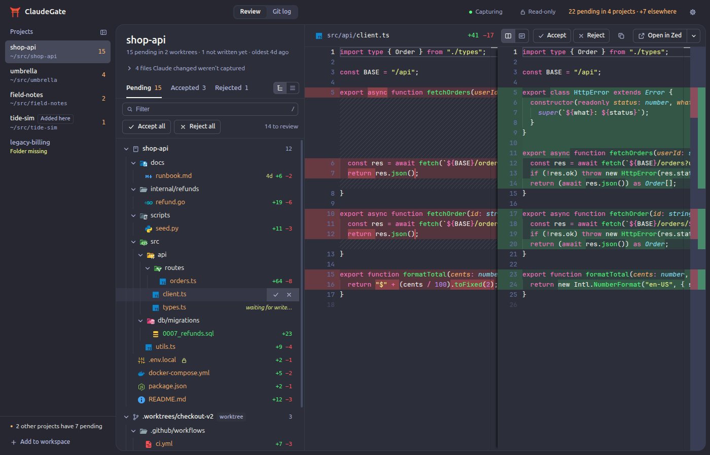

# ClaudeGate Desktop

**Review every file Claude Code edits, then accept or reject it. Rejecting puts the original back.**

[](https://github.com/lntvan166/claudegate-desktop/releases/latest)
[](https://github.com/lntvan166/claudegate-desktop/actions/workflows/ci.yml)
[](LICENSE)



ClaudeGate Desktop is a desktop app for Linux and macOS. A hook saves each file before Claude Code writes it. The app lists those changes per project and shows each one as a diff. You decide per file, folder or project. It works with or without VS Code.

## Features

- **Review Claude's edits.** Pending changes appear as a VS Code-style tree with Monaco diffs. Accept keeps Claude's version. Reject restores the original, and deletes a file Claude created. Single decisions can be undone. Git worktrees and nested repos show as scopes of one project. [Watch the flow](media/review-flow.gif) · [Light theme](media/review-light.png)
- **See what the hook missed.** "Not captured" lists files that a Claude shell command changed but the hook did not record, with the command that changed them. [Screenshot](media/not-captured.png)
- **One log for many repos.** The Git log view merges the commits of every repository in your workspace, with search, author, path, branch and date filters. [Screenshot](media/git-log.png)
- **Review several commits at once.** Combined Changes shows each file once across the commits you select. A ⚠ marks a diff that had to include commits you did not select. [Screenshot](media/combined-changes.png) · [GIF](media/combined-changes.gif)
- **File History, Blame and Compare Branches.** Follow a file across renames, see who last changed a line, and compare two branches across all your repositories. [History](media/file-history.png) · [Blame](media/blame.png) · [Compare](media/compare-branches.png) · [GIF](media/compare-branches.gif)
- **Careful with your files.** A read-only switch, a backup before every session write, and a lock shared with the VS Code extension. [What the app writes](docs/what-the-app-writes.md)

## Install

Download the installer for your system from the [latest release](https://github.com/lntvan166/claudegate-desktop/releases/latest).

**Linux, .deb** (also installs the `claudegate` command):

```bash
pkexec apt install ./ClaudeGate_<version>_amd64.deb
```

**Linux, AppImage:**

```bash
chmod +x ClaudeGate_<version>_amd64.AppImage
./ClaudeGate_<version>_amd64.AppImage
```

**macOS, universal .dmg.** Drag ClaudeGate to Applications. The app is not code-signed, so macOS blocks the first launch. Try to open it once, then go to System Settings → Privacy & Security and click **Open Anyway**. Or clear the quarantine flag:

```bash
xattr -dr com.apple.quarantine /Applications/ClaudeGate.app
```

**Updates.** The app checks for a new release shortly after it starts and then every six hours. On macOS and the AppImage, "Install and restart" checks the update's signature and replaces the app. The app never changes a `.deb` install; it shows an `apt install` command to copy instead.

### Set up capture

The app sees Claude's edits through Claude Code's `PreToolUse` hook, which needs python3.

- **If you use the [ClaudeGate VS Code extension](https://github.com/lntvan166/claudegate),** it has already set the hook up. The header says **Capturing**.
- **If you don't,** click **Not capturing — Set up** in the header. The app asks first, then installs the hook into `~/.claudegate/` and adds its entries to `~/.claude/settings.json`. It backs that file up before writing.

## Quick start

1. Open the app. Click **+ Add to workspace** at the bottom of the rail, then **Choose folder…** and pick your project.
2. Work with Claude Code in that folder as usual.
3. Each file Claude edits appears under **Pending**. Select it to see the diff.
4. Press `A` to accept or `R` to reject. `J` and `K` move between files. `?` lists every shortcut.

From a terminal (the `.deb` installs the command):

```bash
claudegate .          # review the project that owns this folder
claudegate log .      # open the Git log view for the repositories here
```

## How it works

```
Claude Code ──PreToolUse──▶ ~/.claudegate/hook.py ──▶ ~/.claudegate/sessions/<project>.json ──▶ ClaudeGate Desktop
             (before each     (saves the original)      (pending entries, shared                (diff, accept,
              edit)                                       with the VS Code extension)            reject)
```

The hook runs before every `Write`, `Edit`, `MultiEdit` and `Bash` call and stores the original content of the files the call is about to change. For shell commands it reads the command to find them, so a few can slip through; those show up under "Not captured". The app watches the session files and compares each original with the file on disk. Accept removes the entry and keeps the file. Reject writes the original back. See [Architecture](docs/architecture.md).

## Works with the VS Code extension

ClaudeGate Desktop and the [ClaudeGate extension](https://github.com/lntvan166/claudegate) for VS Code and Cursor share the same hook and the same session files. Use either one, or both at once. Both take the same lock before writing, so a decision made in one shows up in the other. The app also works on its own, for example next to Zed or a terminal editor.

## FAQ

**What does it write?**
Your project files only when you reject or reapply a change. Its own settings in `~/.claudegate-desktop/`. The shared session files under `~/.claudegate/`, with a backup before each write. Capture setup writes the hook and its entries in `~/.claude/settings.json`, and only after you confirm. The full list is in [What the app writes](docs/what-the-app-writes.md).

**Can I look without changing anything?**
Turn on read-only mode. The app hides every decision and refuses those writes. Two upkeep writes for projects the app itself added are still allowed; [What the app writes](docs/what-the-app-writes.md) lists them.

**Does it send my code anywhere?**
No. There is no account, no telemetry and no AI call. Everything stays on your machine. The only network request is the update check against GitHub Releases. The Git log view does not fetch.

**Does it write to my git repositories?**
No. The Git log view only runs read commands such as `git log`, `git show` and `git blame`.

**Can I undo a decision?**
Undo reverses the last single-file accept or reject. You can also revert an accepted change to pending, or reapply a rejected one.

**Which platforms?**
Linux (x86_64 `.deb` and AppImage) and macOS (universal `.dmg`). There is no Windows build.

## Documentation

- [User guide](docs/user-guide.md): projects, decisions, read-only mode, capture, Git log, the CLI and Zed
- [What the app writes](docs/what-the-app-writes.md)
- [Architecture](docs/architecture.md)
- [Development](docs/development.md)
- [Releasing](docs/releasing.md)
- [Changelog](CHANGELOG.md)

## Contributing

Bug reports and pull requests are welcome. [CONTRIBUTING.md](CONTRIBUTING.md) covers setup, tests and the rules for test data.

## License

[MIT](LICENSE)
